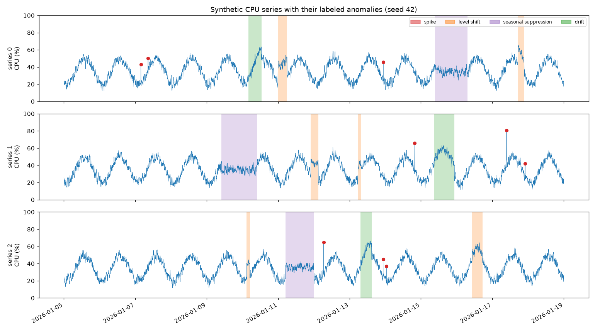
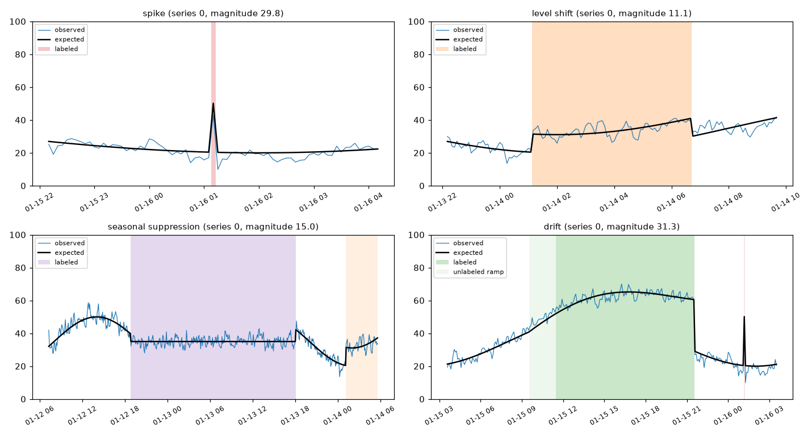

# aiops-observability-platform

Detects anomalies in server metrics and explains each one in plain language with an LLM. Built on a synthetic metrics simulator with ground-truth labels, so detection is measured with precision and recall.

**Status:** In progress. Phase 1 of 7 (synthetic metrics simulator) is complete; Phase 2 (baseline detector) is next. Detection and the LLM explanation layer are planned, not yet built.



## What's built: the simulator

The simulator generates realistic CPU-utilization series with injected anomalies whose exact location and size are known, so detectors can be scored against ground truth.

- **Normal signal:** 14 days at 5-minute intervals (4,032 samples), matching AWS CloudWatch and the Numenta Anomaly Benchmark (NAB). A 35% baseline, a daily cycle peaking at 2 p.m., and AR(1) noise, because real CPU readings are correlated over time.
- **Four anomaly types:** spikes, level shifts, seasonal suppressions (the daily cycle disappears for 12 to 24 hours), and drifts (a slow climb that drops back, like a memory leak ended by a restart).
- **Placement:** a scheduler places 3 spikes, 2 level shifts, 1 suppression, and 1 drift in each series without overlaps, after a one-day warm-up and with at least 2 hours between anomalies.
- **Ground truth kept separate:** labels come from the noise-free signal and are saved apart from the observed data, so a detector can't read the answer key.
- **Reproducible:** one seed produces the whole dataset, and each series has its own independent random stream.



## The dataset

`data/synthetic/` holds 20 series with 140 labeled anomalies, covering about 11% of samples.

| File | Contents |
|---|---|
| `series/series_00.csv` to `series_19.csv` | `timestamp,value`: only what a monitoring system would observe |
| `events.json` | every anomaly's type, window, timestamps, and parameters |
| `metadata.json` | the config, seed, series count, and NumPy version that produced the data |

A test regenerates the dataset from `metadata.json` and fails if the committed files don't match the code byte for byte.

## Quickstart

Requires Python 3.13.

```
git clone https://github.com/shubhamupatel/aiops-observability-platform.git
cd aiops-observability-platform
python -m venv .venv
.venv\Scripts\activate	# on macOS or Linux: source .venv/bin/activate
pip install -r requirements.txt	# the exact versions the project was tested with
pip install -e . --no-deps	# the project itself, without re-resolving versions
pytest
python scripts/generate_dataset.py	# regenerates data/synthetic and the figures
```

## Roadmap

| Phase | Goal | Status |
|---|---|---|
| 1 | Synthetic CPU metrics simulator with labeled anomalies | Done |
| 2 | Baseline detector, scored with precision, recall, F1, and false-positive rate | Next |
| 3 | A second detector from a different family, compared on the same data | Planned |
| 4 | Gemini explanation layer with structured outputs and tool calls | Planned |
| 5 | Prompt design and anti-hallucination evaluation | Planned |
| 6 | Docker and GitHub Actions CI/CD | Planned |
| 7 | Write-up with results | Planned |

Also planned: validation on real AWS CPU data from NAB.

## Known limitations

- No downward spikes or level shifts; the daytime part of a suppression is the only downward deviation.
- Suppression windows include near-normal samples around 8 a.m. and 8 p.m., where the daily cycle crosses its average.
- A single daily cycle with no weekly pattern, and every series shares one server profile.
- CPU only, and anomalies never overlap.
- The sudden drop at the end of a level shift or drift is labeled normal, so a detector that flags it records a false positive.
- Noise correlation and spike length are defined per sample, so changing the sampling interval requires retuning them.

## Layout

```
src/aiops/simulator/	config, generator, anomalies, scheduler, labels, dataset, storage
tests/	127 tests
scripts/	dataset generation and plotting
data/synthetic/	the committed dataset
docs/img/	figures
```

## License

MIT